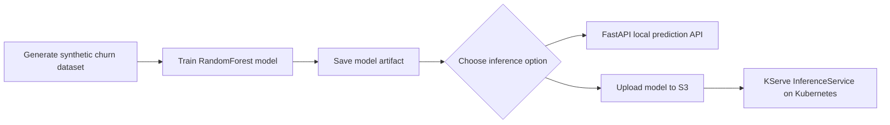

# Churn Prediction MLOps Project

A learning-focused portfolio project that demonstrates how to build, evaluate, and serve a machine learning model for customer churn prediction. The project follows a practical MLOps workflow: synthetic data generation, model training, model artifact persistence, and inference through either a FastAPI service or KServe on Kubernetes.

## Overview

Customer churn is a common business problem where companies want to predict which customers are likely to leave. In this project, a Random Forest classifier is trained to estimate churn risk using a small set of customer behavior and billing features.

## Business Use Case

This model can help teams answer questions like:

- Which customers are at risk of churn?
- Which customers need proactive retention outreach?
- Which product or service signals are most associated with churn risk?

The project uses a synthetic dataset so it is easy to run locally and understand without requiring external data access.

## Architecture



## Project Structure

```text
churn-model/
├── data/
│   └── churn_data.csv.dvc
├── k8s/
│   ├── inference.yaml
│   ├── s3-secret.yaml
│   └── s3-serviceaccount.yaml
├── models/
│   └── churn_model.pkl              # Generated by training
├── src/
│   └── churn_model/
│       ├── __init__.py
│       ├── api.py
│       ├── generate_data.py
│       └── train.py
├── pyproject.toml
├── uv.lock
├── README.md
└── .gitignore
```

## How It Works

1. A synthetic customer dataset is generated with variables such as age, tenure, monthly charges, total charges, and support calls.
2. A Random Forest model is trained on the dataset.
3. The model is evaluated using standard ML metrics such as accuracy and ROC-AUC.
4. The trained model is saved to the `models` directory.
5. The model can be served locally with FastAPI or uploaded to S3 and loaded by KServe.

## Local Setup

### Prerequisites

- Python 3.12+
- UV installed

### Install dependencies

```bash
uv sync
```

Run the following commands from the repository root because the scripts use paths relative to the current working directory.

### Generate the dataset

```bash
uv run python src/churn_model/generate_data.py
```

### Train the model

```bash
uv run python src/churn_model/train.py
```

Training prints accuracy and ROC-AUC metrics and saves the model to `models/churn_model.pkl`.

### Start the API

```bash
uv run fastapi dev src/churn_model/api.py
```

The API loads the saved model when it starts and exposes a health endpoint and a prediction endpoint.

## API Endpoints

### Health check

```bash
curl http://127.0.0.1:8000/health
```

Example response:

```json
{
  "status": "healthy"
}
```

### Prediction

```bash
curl -X POST "http://127.0.0.1:8000/predict" \
  -H "Content-Type: application/json" \
  -d '{
    "age": 35,
    "tenure_months": 18,
    "monthly_charges": 72.5,
    "total_charges": 1305.0,
    "num_support_calls": 3
  }'
```

Example response:

```json
{
  "churn": 1,
  "churn_probability": 0.6874146124
}
```

## Kubernetes Deployment with KServe

The manifests in `k8s/` configure a KServe `InferenceService` named `churn-predictor` in the `ml` namespace. KServe loads the scikit-learn model from S3 using the `sa-s3-access` service account.

### Requirements

- A Kubernetes cluster with KServe installed
- An S3 bucket accessible to the cluster
- AWS CLI configured locally to upload the model
- `kubectl` configured for the target cluster

Train the model locally, then upload it to the path expected by the InferenceService:

```bash
uv run python src/churn_model/train.py
aws s3 cp models/churn_model.pkl s3://<BUCKET_NAME>/model/churn_model.pkl
```

Replace `<BUCKET_NAME>` in `k8s/inference.yaml` with your bucket name. The S3 secret manifest uses the `eu-north-1` region and contains placeholder credentials. Provide valid credentials securely before applying it; do not commit real credentials. In production, use your cluster's approved secrets-management process.

Create the namespace and apply the manifests:

```bash
kubectl create namespace ml
kubectl apply -f k8s/s3-secret.yaml
kubectl apply -f k8s/s3-serviceaccount.yaml
kubectl apply -f k8s/inference.yaml
```

Check the deployment status:

```bash
kubectl get inferenceservice churn-predictor -n ml
```

### Send prediction requests

The examples below assume the KServe model endpoint is accessible at `http://localhost:6009`. Each instance must include the five features in this order: `age`, `tenure_months`, `monthly_charges`, `total_charges`, and `num_support_calls`.

A request with all five features returns a prediction:

```bash
curl -X POST http://localhost:6009/v1/models/churn-predictor:predict \
  -H "Content-Type: application/json" \
  -d '{
    "instances": [
      [45, 24, 79.99, 1920.00, 3]
    ]
  }'
```

Example response:

```json
{"predictions":[1]}
```

Requests with the wrong number of features return an error. For example, this instance provides only three features:

```bash
curl -X POST http://localhost:6009/v1/models/churn-predictor:predict \
  -H "Content-Type: application/json" \
  -d '{
    "instances": [
      [45, 24, 79.99]
    ]
  }'
```

Example error:

```json
{"error":"X has 3 features, but RandomForestClassifier is expecting 5 features as input."}
```

Values outside the ranges used to generate training data may still be accepted by the model, but predictions for such inputs may not be meaningful. For example:

```bash
curl -X POST http://localhost:6009/v1/models/churn-predictor:predict \
  -H "Content-Type: application/json" \
  -d '{
    "instances": [
      [45, 24, 79.99, 11920.00, 13]
    ]
  }'
```

Example response:

```json
{"predictions":[1]}
```

## MLOps Relevance

This project demonstrates the core thinking behind a junior MLOps workflow:

- reproducible model training
- model artifact persistence
- service-oriented inference through a local API or Kubernetes
- clean separation between data, training, and inference logic
- a repository structure suitable for extension with CI/CD, monitoring, and experiment tracking

## License

This project is for portfolio and learning purposes.
