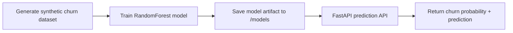

# Churn Prediction MLOps Project

A learning-focused portfolio project that demonstrates how to build, evaluate, and serve a machine learning model for customer churn prediction. The project follows a practical MLOps workflow: synthetic data generation, model training, model artifact persistence, and a FastAPI-based inference service.

## Overview

Customer churn is a common business problem where companies want to predict which customers are likely to leave. In this project, a Random Forest classifier is trained to estimate churn risk using a small set of customer behavior and billing features.

## Business Use Case

This model can help teams answer questions like:

- Which customers are at risk of churn?
- Which customers need proactive retention outreach?
- Which product or service signals are most associated with churn risk?

The project uses a synthetic dataset so it is easy to run locally and understand without requiring external data access.

## Architecture



## Project Structure

```text
churn-model/
├── data/
│   └── churn_data.csv
├── models/
│   └── churn_model.pkl
├── src/
│   └── churn_model/
│       ├── __init__.py
│       ├── api.py
│       ├── generate_data.py
│       └── train.py
├── pyproject.toml
├── README.md
└── .gitignore
```

## How It Works

1. A synthetic customer dataset is generated with variables such as age, tenure, monthly charges, total charges, and support calls.
2. A Random Forest model is trained on the dataset.
3. The model is evaluated using standard ML metrics such as accuracy and ROC-AUC.
4. The trained model is saved to the models directory.
5. A FastAPI app loads the saved model and serves predictions through a REST API.

## Local Setup

### Prerequisites

- Python 3.12+
- UV installed

### Install dependencies

```bash
uv sync
```

### Generate the dataset

```bash
uv run python src/churn_model/generate_data.py
```

### Train the model

```bash
uv run python src/churn_model/train.py
```

### Start the API

```bash
uv run fastapi dev src/churn_model/api.py
```

The app will run locally and expose a health endpoint and a prediction endpoint.

## API Endpoints

### Health check

```bash
curl http://127.0.0.1:8000/health
```

Example response:

```json
{
  "status": "healthy"
}
```

### Prediction

```bash
curl -X POST "http://127.0.0.1:8000/predict" \
  -H "Content-Type: application/json" \
  -d '{
    "age": 35,
    "tenure_months": 18,
    "monthly_charges": 72.5,
    "total_charges": 1305.0,
    "num_support_calls": 3
  }'
```

Example response:

```json
{
  "churn": 1,
  "churn_probability": 0.6874146124
}
```

## MLOps Relevance

This project demonstrates the core thinking behind a junior MLOps workflow:

- reproducible model training
- model artifact persistence
- service-oriented inference layer
- clean separation between data, training, and deployment logic
- a repository structure suitable for extension with CI/CD, monitoring, and experiment tracking

## Planned Improvements

The next steps for this project are focused on moving from a local ML prototype toward a more structured MLOps workflow:

- containerize the API service with Docker
- add automated CI/CD checks for linting and tests
- introduce a model registry for artifact tracking
- integrate MLflow for experiment tracking and reproducibility
- add test coverage for the training and inference workflow
- improve deployment readiness for cloud or internal environments

## License

This project is for portfolio and learning purposes.
